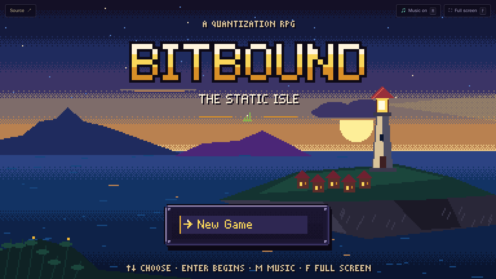
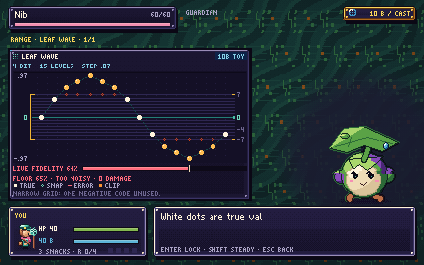

<p align="center"><a href="https://mottopanikeiku.github.io/bitbound-quantization-quest/"></a></p>

# Bitbound

A pixel-art RPG about quantization that you can [play in the browser](https://mottopanikeiku.github.io/bitbound-quantization-quest/) with a keyboard or a phone. Each spell is a grid. You pick a bit width and a range, lock it, and the enemy's numbers snap to the nearest levels; the closer they land to where they started, the harder the spell hits.



White dots are the true values, red tethers show the rounding error and orange dots got clipped. Every cast costs bytes, so the byte budget is your mana bar: more bits make a better spell and leave less for the next turn. Between casts you can time a guard against the enemy's attack, brace to win bytes back, or use TUNE and SCAN (both free) to look at what went wrong.

## The island

Seven guardians each teach one technique through a battle and a bridge puzzle.

| Guardian | Technique | What it teaches |
| --- | --- | --- |
| Nib | Bit Dial | Bit width sets the number of levels, and the range trades rounding against clipping |
| Chime | Zero-Shift | A zero-point lets an affine grid fit mostly-positive values |
| Brine | Tide Gauge | Calibrate a range on sample data, then face inputs you haven't seen |
| Spindle | Group Rulers | Separate scales keep small values alive next to large ones |
| Cinder | Spotlight | Weights paired with big inputs matter more |
| Vesper | Balance | SmoothQuant-style rescaling moves range between activations and weights |
| Auric | Bit Budget | Mixed precision spends more bits on sensitive heads |

Befriending them brings the island's colours back. After two friends you can drop into the Static Well, a seeded dungeon with a warden every fifth floor. There are also 21 staticling species to collect, rival duels against Fen Float and a Journal that keeps track of it all.

The tensors are small hand-made examples, not weights from a real model. Formulas, packet layout and paper links are in [RESEARCH.md](RESEARCH.md).

## Development

Node 22.12 or newer:

```sh
npm ci
npm run dev
```

`npm test` runs the game-logic tests and `npm run build` makes the production bundle. In dev, `?battle=nib` drops you straight into the first fight.

WASD or arrows to move, Enter or Space to confirm, Shift to run, J for the Journal, M for music. Phones get an on-screen pad. Saves stay in the browser.

It is plain JavaScript, Canvas and Web Audio. The sprites, tiles, pixel font and music are all generated in code. [MIT licensed](LICENSE).
