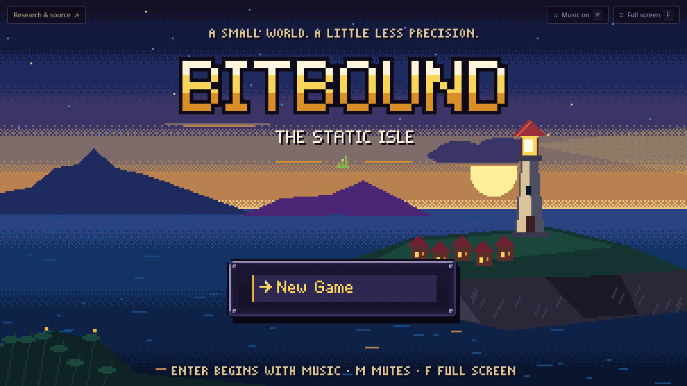
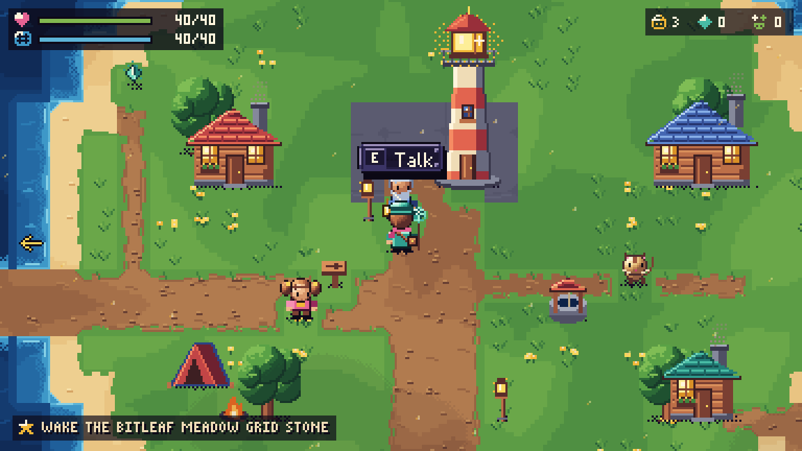

# Bitbound

A pixel-art RPG about quantization for inference. Each spell rounds the values on screen; its damage depends on the reconstruction error, and its cost depends on the bytes it uses.

<p>
<a href="https://mottopanikeiku.github.io/bitbound-quantization-quest/"></a>
<a href="https://mottopanikeiku.github.io/bitbound-quantization-quest/"></a>
</p>

**[Play in your browser](https://mottopanikeiku.github.io/bitbound-quantization-quest/)**. Keyboard and touch controls. Saves stay in your browser; no account or download.

## What you learn

Seven island regions each teach a technique through a guardian battle and a bridge puzzle. You choose the bit width, fit a range around the values, then watch them snap to the nearest level. Red tethers show rounding error; orange values show clipping.

| Guardian | Technique | Quantization concept |
| --- | --- | --- |
| Nib | Bit Dial | Bit width sets the number of levels; range trades rounding error against clipping |
| Chime | Zero-Shift | An affine grid uses a zero-point to fit mostly-positive values |
| Brine | Tide Gauge | Calibration uses sample data to choose a range for inputs you have not seen yet |
| Spindle | Group Rulers | Per-channel and group-wise scales preserve small values beside large ones |
| Cinder | Spotlight | Weights paired with large inputs contribute more to output error |
| Vesper | Balance | SmoothQuant-style rescaling moves range between activations and weights before rounding |
| Auric | Bit Budget | Mixed precision spends more bits on sensitive heads |

More bits make a cast expensive. A smaller packet leaves you more bytes for the next turn. TUNE and SCAN are free, so you can inspect the last cast and change your approach. Between casts, time a guard against the enemy's attack or brace to recover bytes.

The arithmetic uses small example tensors and JavaScript numbers. Fidelity measures reconstruction error; HP, damage and grades are game rules. The game illustrates inference concepts without running a model or measuring hardware performance. [Quantization notes](RESEARCH.md) explain the formulas, packet layout and links to the papers.

## Around the island

Befriend the seven guardians to restore the island's colours and call on their techniques in later fights. There are 21 staticling species, shrine rematches and three packet-budget duels against Fen Float. Battle grades reward fidelity, small packets, guard timing and fewer turns.

The Island Journal tracks the map, species, 20 badges and your battle records. Rest at camps to open fast travel, solve the seven bridges and collect shards to expand your byte supply.

After making two friends, enter the Static Well at Lighthouse Point. It generates battles from a replayable seed, with a warden every fifth floor and a choice of boons between some floors. Runs use separate supplies and can be suspended between fights. Hats and golden creatures are cosmetic.

## Controls

| Keyboard | Action |
| --- | --- |
| WASD / arrows | Walk or choose a menu item |
| Enter / Space / E | Talk, confirm, lock a grid or time a guard |
| Shift | Run; slow the moving bracket while locking a grid |
| Esc / P | Pause; Esc also goes back |
| J / N | Island Journal / Field Notes |
| M / F | Toggle music / full screen |

On phones, use the D-pad, **A** to act, **B** to go back and **START** to pause. Hold **STEADY** to run or slow a grid lock. Starting the game enables music and requests full screen; F or the pause menu changes it. To flee a fight, use the pause menu.

## Run locally

Requires Node.js 22.12 or newer.

```sh
npm ci
npm run dev
```

Open the local URL printed by Vite. To test and serve the production build:

```sh
npm test
npm run build
npm run preview
```

The tests cover quantization arithmetic, battle rules, saves, progress, Well runs, world navigation and lesson layouts. GitHub Actions runs the tests and deploys `main` to Pages. The build writes to `dist/`.

The game uses plain JavaScript, Canvas and Web Audio. Sprites, tiles, the pixel font and music are generated in code. [MIT licensed](LICENSE).
